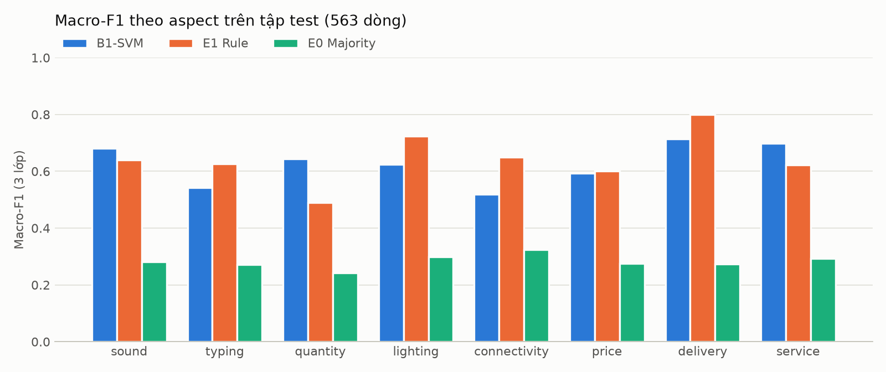
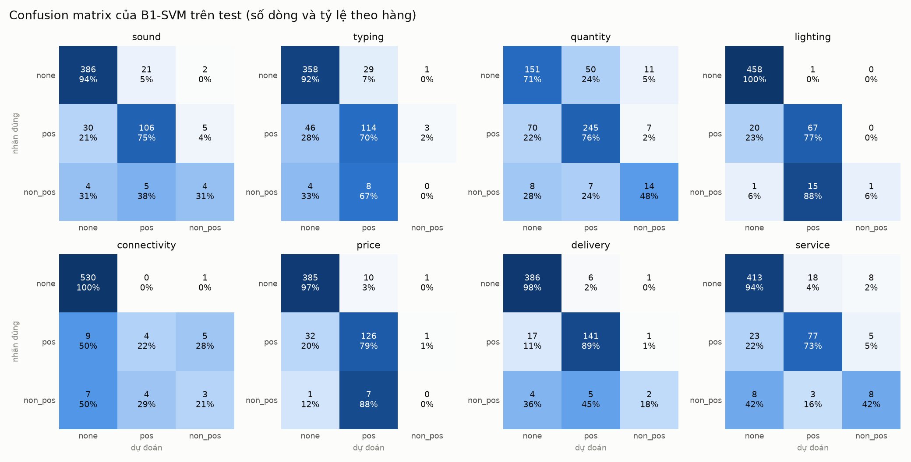

# Test report (bước 4)

Model: **A1** (C=1, class_weight=balanced, word.min_df=2, word.ngram_range=(1, 1)), CV trên train 0.6468 ± 0.0175. Tập test: 563 dòng, đánh giá một lần (chạy lại với --force: chỉ sửa định dạng bảng báo cáo, model và dự đoán không đổi).

## Kết quả chính

| model | mean_macro_f1 | CI 95% (bootstrap) | mean_accuracy | detection_f1 |
|---|---|---|---|---|
| B1-SVM | 0.627 | 0.598 – 0.654 | 0.883 | 0.817 |
| E1 Rule | 0.643 | 0.621 – 0.667 | 0.857 | 0.852 |
| E0 Majority | 0.282 | 0.279 – 0.285 | 0.741 | 0.382 |

- Chênh lệch B1-SVM − E1 (bootstrap 1000 lần): CI 95% -0.051 – +0.019; B1-SVM cao hơn E1 trong 16% số lần bootstrap.

## Macro-F1 theo aspect

| model | sound | typing | quantity | lighting | connectivity | price | delivery | service |
|---|---|---|---|---|---|---|---|---|
| B1-SVM | 0.68 | 0.542 | 0.643 | 0.625 | 0.518 | 0.593 | 0.713 | 0.698 |
| E1 Rule | 0.639 | 0.627 | 0.49 | 0.723 | 0.649 | 0.6 | 0.799 | 0.622 |
| E0 Majority | 0.281 | 0.272 | 0.243 | 0.299 | 0.324 | 0.275 | 0.274 | 0.292 |

## B1-SVM: precision / recall / F1 từng lớp

| aspect | none | pos | non_pos |
|---|---|---|---|
| sound | P 0.92 · R 0.94 · F1 0.93 (n=409) | P 0.80 · R 0.75 · F1 0.78 (n=141) | P 0.36 · R 0.31 · F1 0.33 (n=13) |
| typing | P 0.88 · R 0.92 · F1 0.90 (n=388) | P 0.75 · R 0.70 · F1 0.73 (n=163) | P 0.00 · R 0.00 · F1 0.00 (n=12) |
| quantity | P 0.66 · R 0.71 · F1 0.68 (n=212) | P 0.81 · R 0.76 · F1 0.79 (n=322) | P 0.44 · R 0.48 · F1 0.46 (n=29) |
| lighting | P 0.96 · R 1.00 · F1 0.98 (n=459) | P 0.81 · R 0.77 · F1 0.79 (n=87) | P 1.00 · R 0.06 · F1 0.11 (n=17) |
| connectivity | P 0.97 · R 1.00 · F1 0.98 (n=531) | P 0.50 · R 0.22 · F1 0.31 (n=18) | P 0.33 · R 0.21 · F1 0.26 (n=14) |
| price | P 0.92 · R 0.97 · F1 0.95 (n=396) | P 0.88 · R 0.79 · F1 0.83 (n=159) | P 0.00 · R 0.00 · F1 0.00 (n=8) |
| delivery | P 0.95 · R 0.98 · F1 0.96 (n=393) | P 0.93 · R 0.89 · F1 0.91 (n=159) | P 0.50 · R 0.18 · F1 0.27 (n=11) |
| service | P 0.93 · R 0.94 · F1 0.94 (n=439) | P 0.79 · R 0.73 · F1 0.76 (n=105) | P 0.38 · R 0.42 · F1 0.40 (n=19) |

## B1-SVM: phát hiện aspect (có nhắc hay không)

| aspect | support (có nhắc) | precision | recall | f1 |
|---|---|---|---|---|
| sound | 154 | 0.839 | 0.779 | 0.808 |
| typing | 175 | 0.806 | 0.714 | 0.758 |
| quantity | 351 | 0.817 | 0.778 | 0.797 |
| lighting | 104 | 0.988 | 0.798 | 0.883 |
| connectivity | 32 | 0.941 | 0.5 | 0.653 |
| price | 167 | 0.924 | 0.802 | 0.859 |
| delivery | 170 | 0.955 | 0.876 | 0.914 |
| service | 124 | 0.782 | 0.75 | 0.765 |
| micro (8 aspect) |  | 0.861 | 0.778 | 0.817 |
| macro (8 aspect) |  | 0.882 | 0.75 | 0.805 |

## B1-SVM: khen hay không khen (chỉ trên các dòng có nhắc theo nhãn đúng)

| aspect | support | macro_f1 (pos/non_pos) | dự đoán none (bỏ sót) |
|---|---|---|---|
| sound | 154 | 0.602 | 34 |
| typing | 175 | 0.4 | 50 |
| quantity | 351 | 0.707 | 78 |
| lighting | 104 | 0.452 | 21 |
| connectivity | 32 | 0.29 | 16 |
| price | 167 | 0.432 | 33 |
| delivery | 170 | 0.605 | 21 |
| service | 124 | 0.666 | 31 |

## B1-SVM: lớp non_pos tách theo điểm gốc (neg 1–4, neu 5–6)

Số dòng được dự đoán đúng lớp / tổng số dòng có điểm gốc thuộc nhóm đó.

| aspect | neg → non_pos | neu → non_pos | pos → pos |
|---|---|---|---|
| sound | 4/9 | 0/4 | 106/141 |
| typing | 0/5 | 0/7 | 114/163 |
| quantity | 10/17 | 4/12 | 245/322 |
| lighting | 1/9 | 0/8 | 67/87 |
| connectivity | 1/7 | 2/7 | 4/18 |
| price | – | 0/8 | 126/159 |
| delivery | 2/7 | 0/4 | 141/159 |
| service | 6/14 | 2/5 | 77/105 |

## Confusion matrix

